<table width="100%">
  <tr>
    <td width="300" align="left" valign="top">
      <a href="https://mrmybal.github.io/CyUI/fr/">Présentation</a><br>
      <a href="Documentation/Documentation.html#/fr/overview">Manuel hors ligne</a><br>
      <a href="https://github.com/MrMybal/CyUI">GitHub</a><br><br>
      <sub>README</sub><br>
      <a href="README.md">English</a> · <a href="README.fr.md">Français</a>
    </td>
    <td width="400" align="center" valign="middle">
      <a href="https://mrmybal.github.io/CyUI/fr/"></a>
    </td>
    <td width="300" align="right" valign="top">
      <p><sub>Licence de la bibliothèque</sub><br><a href="LICENSE"><strong>MIT</strong></a></p>
      <p><sub>Versions</sub><br><a href="VERSION.fr.md"><strong>Bibliothèque 1.2.0</strong><br><strong>Démo 1.2.0</strong></a><br><strong>EN DÉVELOPPEMENT</strong></p>
      <p><a href="https://github.com/MrMybal/CyUI/releases/download/v1.2.0/CyUI-Demo-1.2.0-windows-x64.zip"><strong>Télécharger la démo</strong></a><br><sub>Windows x64 · portable</sub></p>
    </td>
  </tr>
</table>

<h1 align="center">CyUI</h1>

Une bibliothèque d’interface thématisée et modulaire fondée sur **Dear ImGui 1.92+**,
pour les développeurs d’éditeurs de bureau, de logiciels créatifs et d’outils
techniques. Construisez une interface cohérente en C++ ou en Python, en partant
de Core et en sélectionnant les modules utiles à votre application.

> **EN DÉVELOPPEMENT · Bibliothèque 1.2.0 · Démo 1.2.0**
>
> Essayez la galerie Windows publiée, puis intégrez la bibliothèque à votre
> application. Les sources actuelles incluent le manuel bilingue CyDoc ; la démo
> publiée est un instantané antérieur. Consultez les [notes de version et limites documentées](VERSION.fr.md).

[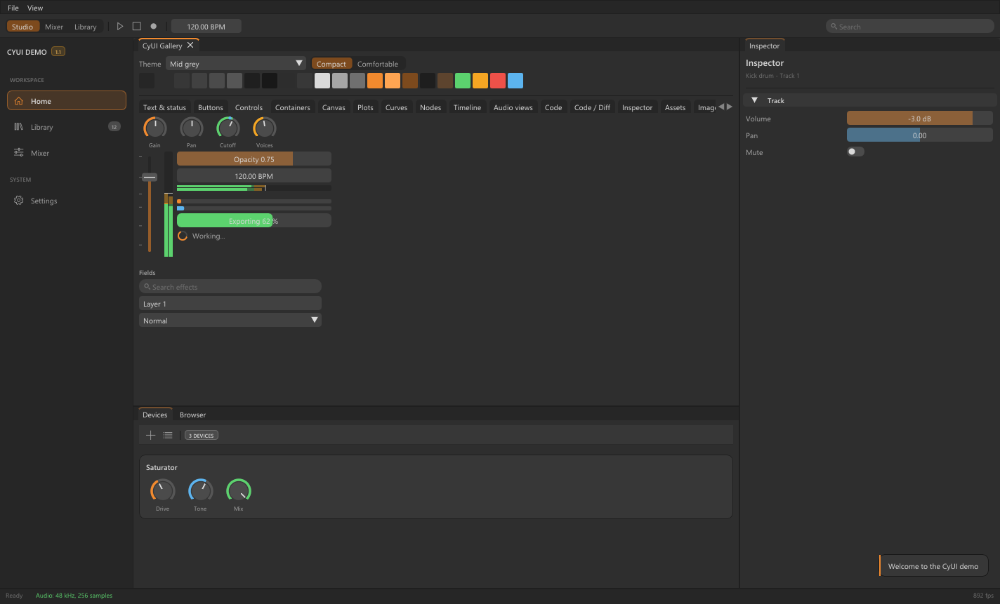](docs/screenshots/mid-grey.png)

## À propos de CyUI

Utilisez la même base visuelle pour les formulaires, navigateurs de contenu,
panneaux de propriétés, vues audio, courbes éditables, graphes à nœuds, éditeurs
de code et chronologies. L’application conserve ses données, son rendu, ses
moteurs de traitement, ses opérations sur les fichiers, ses services de langage
et son historique d’annulation. CyUI fournit les composants d’interface.

CyUI vise **Windows, Linux et macOS** à travers les backends ImGui de
l’application hôte. La démo portable disponible est pour Windows x64 ; les
cibles Linux/macOS de la bibliothèque sont fournies sous forme de sources.
La navigation CEF et l’intégration dans Unreal Editor sont optionnelles et
utilisent des runtimes fournis séparément.

### Aperçu des modules

Ces captures proviennent de la galerie C++ en cours d’exécution. Les exemples
utilisent des données synthétiques ; les applications fournissent leurs propres
modèles, rendu, traitements et services.

#### Vues audio

Formes d’onde stéréo, spectres logarithmiques, oscilloscopes et vues stéréo
partagent la palette des potentiomètres, faders et indicateurs. `AudioViews`
affiche des données préparées ; le décodage audio, les FFT et le DSP restent
dans l’application.

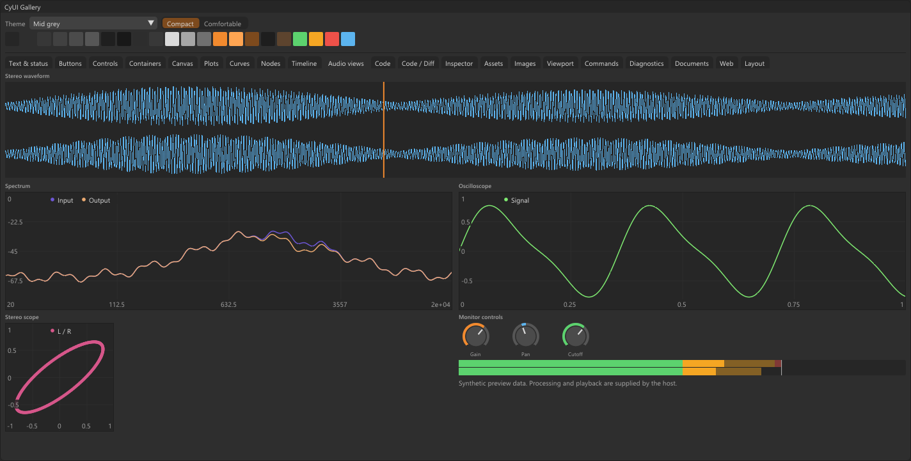

AudioViews propose aussi un spectrogramme, les vues LUFS/LRA et crête vraie, un historique de corrélation, des points EQ éditables avec superposition gain/phase, ainsi que les courbes de dynamique et la réduction de gain. Ces ajouts sont disponibles dans les sources actuelles et l’onglet Analyse audio de la galerie.

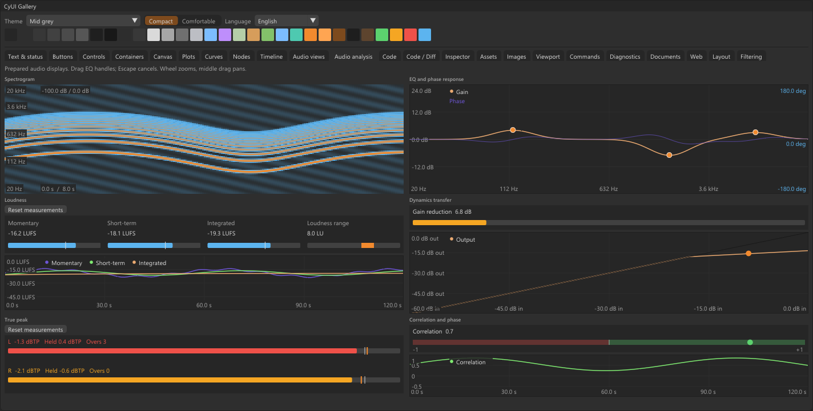

L’onglet Vues spectrales ajoute spectres remplis/dégradés, barres fréquentielles avec plancher dB, spectrogrammes défilants légendés, vue spatiale stéréo et vectorscopes à persistance.

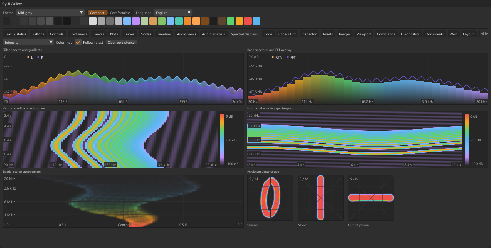

#### Graphes à nœuds de type blueprint

Ports colorés, liaisons courbes, sélection, déplacement, navigation, zoom et
disposition automatique forment une base pour les éditeurs visuels.
L’application définit la compatibilité des ports, la validation et l’exécution
du graphe.

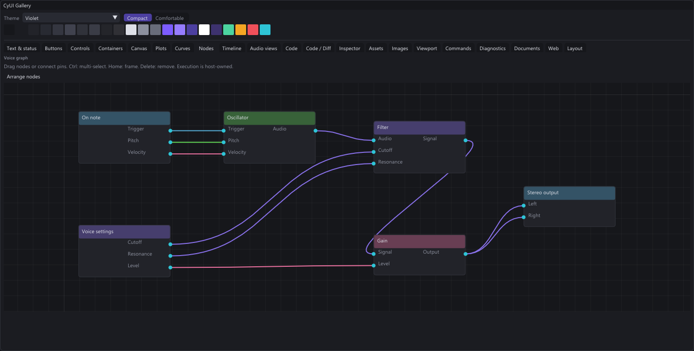

#### Graphes de traitement d’image

Les cartes des nœuds peuvent afficher les textures fournies par l’application
avec leurs ports et connexions. Cet exemple présente une image source, un
étalonnage, un flou et des aperçus de sortie. La démo prépare ces images côté
hôte ; `Nodes` dessine le graphe et son contenu.

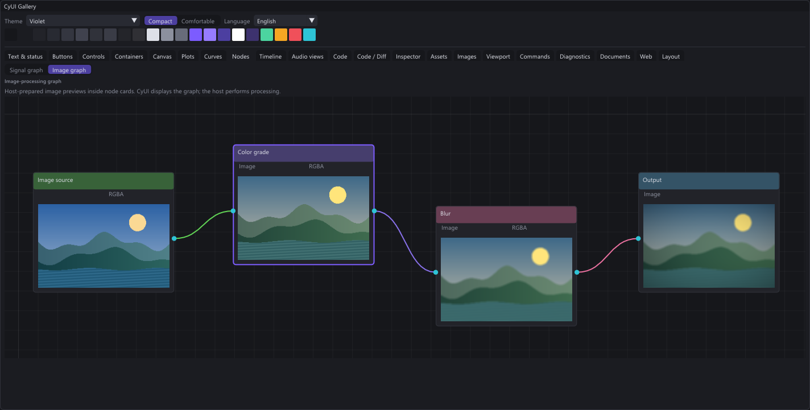

#### Navigateurs de contenu et panneaux de propriétés

Associez `Assets`, navigation dans les dossiers, vignettes et métadonnées de
sélection pour construire un navigateur de contenu. Stockage, importations et
opérations sur les fichiers restent dans l’application.

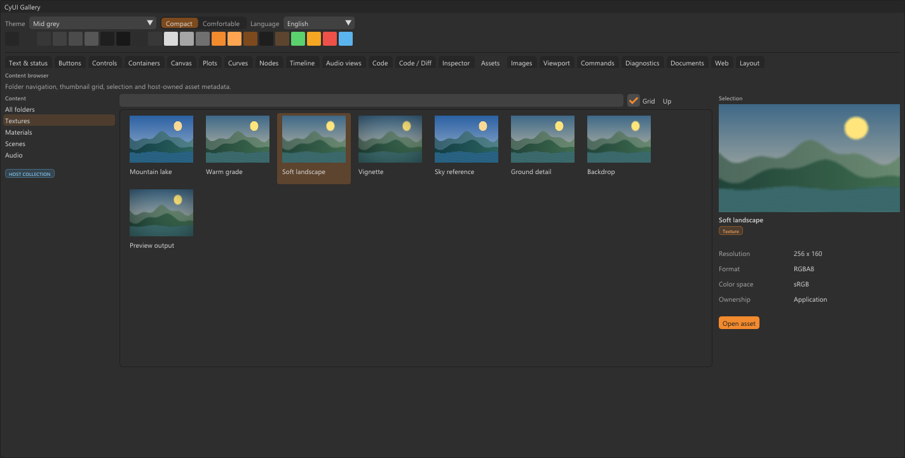

`Inspector` propose des propriétés typées et éditables dans des sections
repliables : chaînes, choix, interrupteurs, entiers exacts, valeurs numériques
et champs en lecture seule. L’application gère la validation et les transactions
d’annulation.


#### Édition et comparaison de code

`Code` fournit les vues de sources avec coloration syntaxique et annotations.
`CodeEditor` ajoute l’édition native, l’annulation/rétablissement et des points
d’extension avancés. `Diff` présente les comparaisons unifiées ou côte à côte ;
l’accès au dépôt reste dans l’application. Le lecteur Diff natif utilise une
surface de défilement commune aux deux colonnes, pour conserver l’alignement
des lignes avec la molette, le pavé tactile et les barres de défilement.
Les longues lignes partagent un décalage horizontal tandis que leurs numéros
restent visibles. Consultez le [guide Diff](Documentation/Documentation.html#/fr/diff).

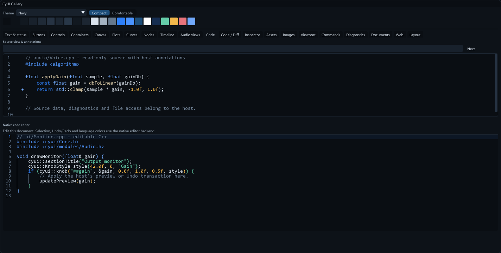

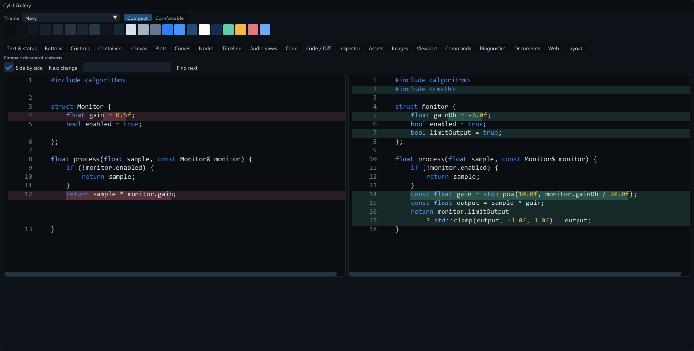

#### Graphiques, automation et chronologies

| Réponse en fréquence, distributions et cartes de chaleur | Courbes d’automation éditables |
| --- | --- |
| 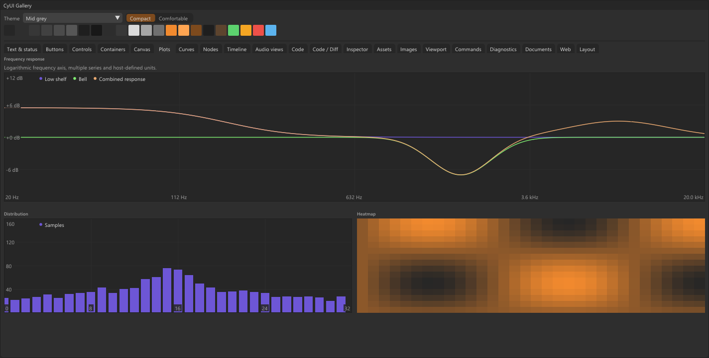 | 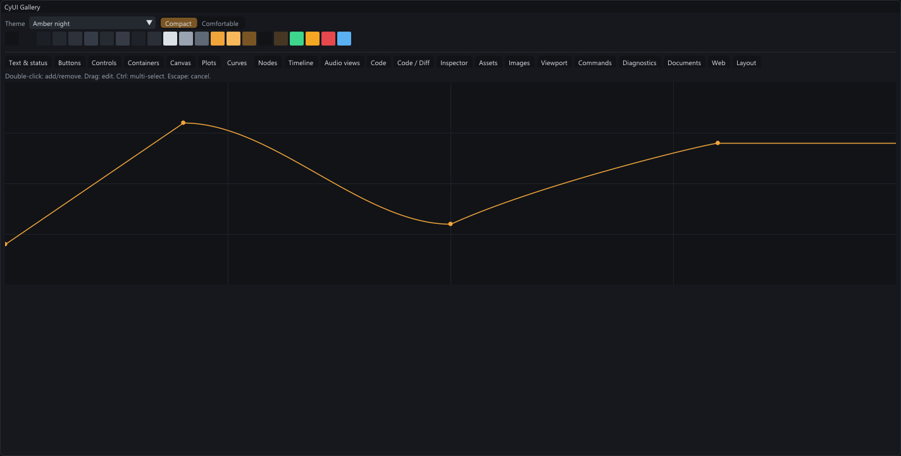 |

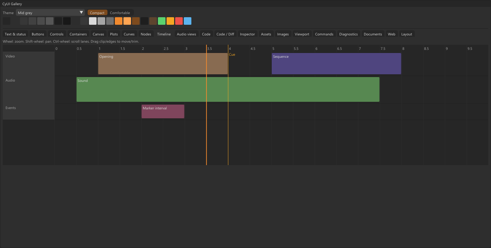

#### Trouver rapidement les actions et propriétés

Core inclut des filtres rapides optionnels pour les panneaux, sections de
propriétés et menus imbriqués. Recherchez les libellés anglais ou traduits,
ignorez les accents latins et retrouvez les actions des sous-menus avec leur
chemin. Chaque vue conserve sa requête. Consultez les
[API et exemples de filtrage](Documentation/Documentation.html#/fr/filtering).

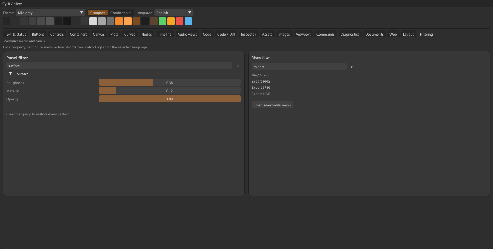

## Interfaces multilingues, anglais par défaut

Core inclut des catalogues anglais et français, le changement de langue à chaud
et une API pour les traductions de l’application et d’autres langues. Utilisez
`trLabel()` pour garder des identifiants de widgets stables et `tr()` pour le
texte. L’API Python et la passerelle Web embarquée utilisent les mêmes messages
intégrés. Consultez les [règles de localisation et d’intégration](Documentation/Documentation.html#/fr/localization).

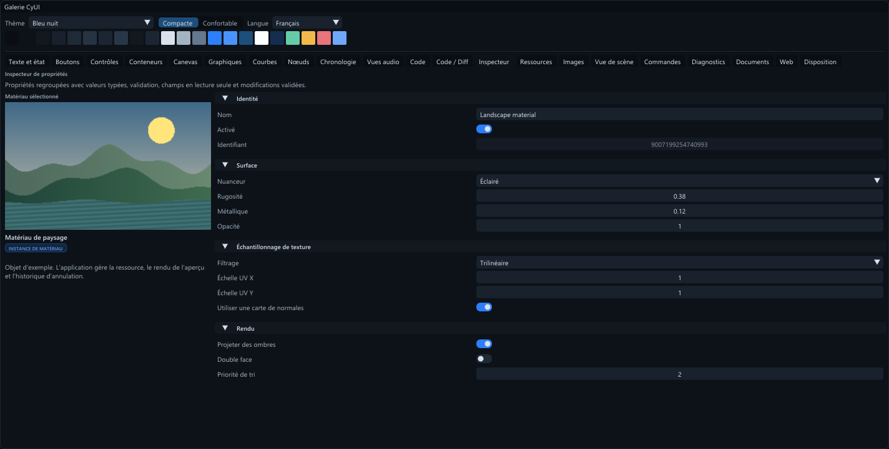

## Thèmes et dimensions

Cinq thèmes intégrés partagent des rôles de couleurs sémantiques et deux densités,
**compacte** et **confortable**. Utilisez `cyui::palette()` pour les couleurs
d’interface et `cyui::dp()` ou les métriques du style ImGui pour les dimensions.
Les thèmes peuvent être édités et enregistrés au format `.cytheme`.

| Clé | Apparence |
| --- | --- |
| `mid-grey` | Gris moyens avec accent orange ; thème par défaut |
| `light-grey` | Surfaces claires, texte sombre et accent orange |
| `amber-night` | Surfaces bleu-gris foncé avec accent ambré |
| `violet` | Surfaces ardoise foncé avec accent violet |
| `navy` | Surfaces bleu marine avec accent bleu |

| Gris clair | Violet | Bleu nuit |
| --- | --- | --- |
| 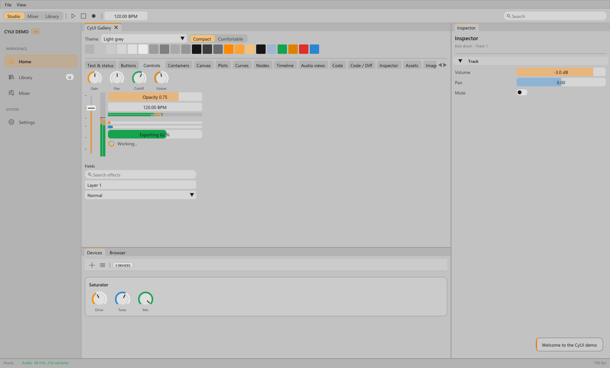 | 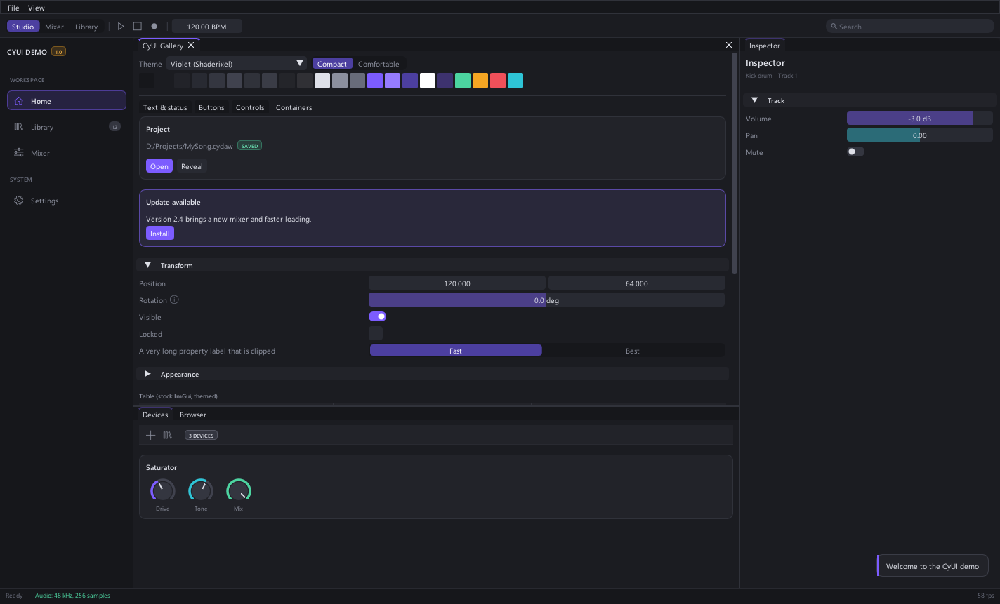 | 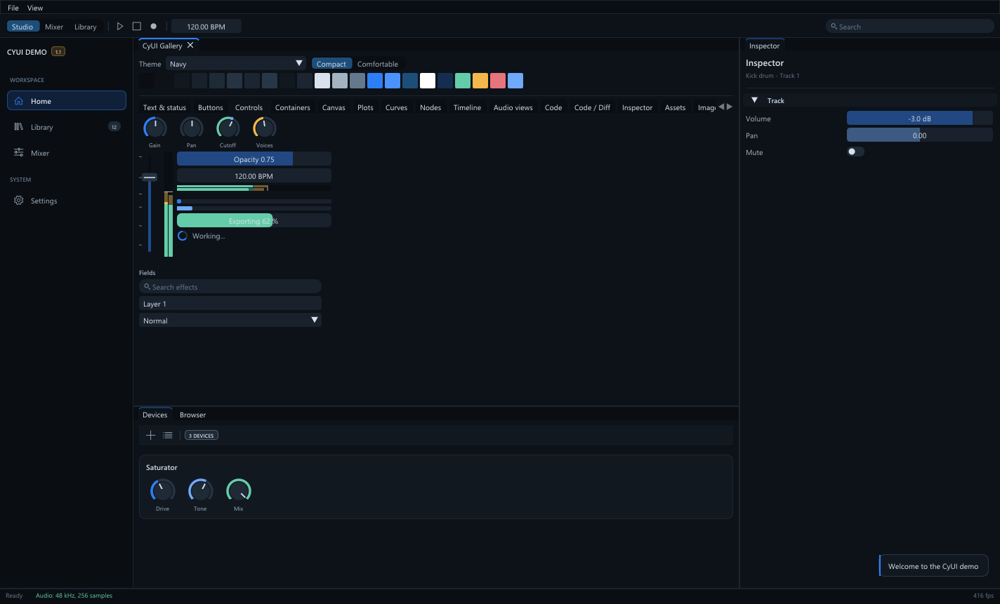 |

Les polices et icônes sont chargées depuis le système d’exploitation ou les
fichiers fournis par l’application, sans redistribution. Fournissez des polices
et solutions de repli adaptées aux plateformes et écritures prises en charge.
Thème, DPI, polices et notifications appartiennent à chaque contexte ImGui ;
initialisez chaque contexte séparément.

## Choisir ses modules

Chaque module C++ est une cible de bibliothèque statique distincte.
Les dépendances entre modules sont sélectionnées automatiquement ; par exemple,
`Diff` ajoute `Code` et Core, sans éditeur de code, moteur audio ni navigateur.

| Cible | Fonctionnalités |
| --- | --- |
| `CyUI::Core` | Thèmes, localisation, filtres rapides, polices, icônes, boutons, champs, cartes, tableaux, disposition et notifications |
| `CyUI::Audio` | Potentiomètres, faders et indicateurs de crête/RMS |
| `CyUI::Canvas` | Grille, découpage, coordonnées double précision, déplacement et zoom |
| `CyUI::Plots` | Graphiques linéaires/logarithmiques, lignes, points, paliers, barres, histogrammes et cartes de chaleur |
| `CyUI::Curves` | Images clés, poignées de Bézier, alignement, sélection et transactions d’édition |
| `CyUI::Nodes` | Cartes et ports reliés, navigation et disposition du graphe |
| `CyUI::Timeline` | Pistes de clips, ajustement des bords, marqueurs, tête de lecture et sélection de plage |
| `CyUI::AudioViews` | Formes d’onde, spectre, spectrogramme, LUFS/crête vraie, corrélation, EQ/phase et dynamique |
| `CyUI::Code` | Vues de sources, coloration syntaxique, annotations et recherche |
| `CyUI::CodeEditor` | Édition des sources avec le backend TextEditor MIT fourni |
| `CyUI::Diff` | Comparaisons unifiées/côte à côte, différences dans les lignes et navigation entre blocs modifiés |
| `CyUI::Inspector` | Propriétés typées, validation et brouillons de modification |
| `CyUI::Assets` | Arborescences, grilles/listes, vignettes, filtrage et glisser-déposer |
| `CyUI::Images` | Navigation dans les images, damier, recadrage et points de dégradé |
| `CyUI::Viewport` | Surfaces de scène rendues par l’hôte, caméra orbitale et contrôles de transformation 2D |
| `CyUI::Commands` | Palette de commandes au clavier avec recherche |
| `CyUI::Diagnostics` | Journaux à taille limitée, filtres et navigation dans les diagnostics |
| `CyUI::DocumentViews` | Sous-ensemble Markdown, blocs de code, tableaux, liens et conversations |
| `CyUI::Web` | Surface de navigateur, entrées, politique d’origine, messages et passerelle de thème |
| `CyUI::Gallery` | Exemples de widgets/modules et éditeur de thème |

Les adaptateurs optionnels `CyUI::WebCEF` et `CyUI::ImGuizmo` utilisent des
dépendances fournies par l’application. Aucun n’est téléchargé ou activé par
`CYUI_MODULES=All`. Consultez les [dépendances et API des modules](Documentation/Documentation.html#/fr/modules).

---

## Installation

### Essayer la démo Windows portable

1. [Téléchargez CyUI Demo 1.2.0 pour Windows x64](https://github.com/MrMybal/CyUI/releases/download/v1.2.0/CyUI-Demo-1.2.0-windows-x64.zip).
2. Extrayez **toute l’archive** dans un dossier accessible en écriture et lancez `cyui_demo.exe`.
3. Utilisez `Launch-French.cmd` pour le français, ou changez la langue et le thème dans la galerie.

L’exécutable utilise **Windows x64 et DirectX 11**. Aucun outil de compilation,
Python ou runtime Visual C++ séparé n’est nécessaire. Consultez les
[notes de publication et sommes de contrôle](https://github.com/MrMybal/CyUI/releases/tag/v1.2.0).
Aucune démo binaire Linux/macOS n’est publiée. La démo ordinaire n’embarque ni
CEF ni Unreal Engine ; sa page Web nécessite une compilation avec CEF pour
la navigation en direct.

### Lire le manuel local

Ouvrez [Documentation/Documentation.html](Documentation/Documentation.html#/fr/overview)
depuis les sources récupérées ou une distribution compilée avec les sources
actuelles. Conservez tout le dossier `Documentation/`. Le véritable lecteur
CyDoc fournit navigation anglais/français, recherche, recettes API et
agrandissement des images dans la fenêtre. La lecture ne nécessite ni serveur,
ni CDN, ni compte, ni connexion Internet.

Dans les builds actuels, **Aide → Documentation** ou **F1** ouvre le manuel dans
la langue de la démo. La galerie Python fournit aussi une aide contextuelle.
Sur GitHub, le lien du fichier HTML ouvre son aperçu source ; ouvrez le fichier
HTML téléchargé dans un navigateur pour lire le manuel. L’ancien ZIP 1.2.0
publié précède cette intégration de l’aide.

## Sources, compilation et bibliothèques nécessaires

### Prérequis

- **C++17** et **Dear ImGui >= 1.92** pour Core ; **C++20** pour CodeEditor et l’adaptateur CEF testé.
- **CMake >= 3.16** pour l’intégration de la bibliothèque. Le script de compilation de la démo Windows utilise les **outils C++ x64 de Visual Studio 2022**, sans CMake.
- **Python >= 3.10** et `imgui-bundle >= 1.92` pour l’interface Python.
- **Node.js >= 22**, npm et Python >= 3.10 uniquement pour régénérer la documentation. Le manuel exporté n’en a pas besoin.
- **Pillow** uniquement pour les scripts optionnels de capture d’écran.

### Récupérer les sources

```sh
git clone https://github.com/MrMybal/CyUI.git
cd CyUI
```

Pour le développement local, installez [Gitleaks](https://github.com/gitleaks/gitleaks/releases)
et activez le hook pre-commit fourni dans votre copie du dépôt :

```sh
git config --local core.hooksPath .githooks
```

### Intégrer la bibliothèque C++

<details>
<summary>Sélection des modules, initialisation et compatibilité</summary>

Prérequis : **Dear ImGui >= 1.92**, **C++17** et **CMake >= 3.16**.
CodeEditor et l’adaptateur CEF optionnel demandent C++20. La branche docking
d’ImGui est recommandée pour les applications utilisant l’ancrage.

Ajoutez CyUI aux sources, par exemple dans `external/CyUI`. Fournissez votre
cible ImGui existante pour que l’application et CyUI partagent une seule
instance ImGui :

```cmake
set(CYUI_IMGUI_TARGET app_imgui)
set(CYUI_BUILD_DEMO OFF)
set(CYUI_BUILD_AUDIO OFF)
set(CYUI_BUILD_GALLERY OFF)
set(CYUI_MODULES "Diff;Inspector")
add_subdirectory(external/CyUI)

target_link_libraries(app PRIVATE CyUI::Diff CyUI::Inspector)
```

Utilisez `CYUI_MODULES "Core"` et `CyUI::Core` pour la base seule. Incluez
`<cyui/Core.h>` et les en-têtes des modules utilisés :

```cpp
#include <cyui/Core.h>
#include <cyui/modules/Diff.h>
#include <cyui/modules/Inspector.h>

// Après ImGui::CreateContext(), avant la première frame :
cyui::Config config;
config.themeKey = "mid-grey";
config.density = cyui::Density::compact;
config.dpiScale = dpiScale;
cyui::apply(config);
cyui::loadFonts();

// Pendant une frame ImGui :
if (cyui::primaryButton(cyui::trLabel("Save").c_str())) {
    saveDocument();
    cyui::notify(cyui::tr("Saved").c_str(), cyui::Tone::success);
}
cyui::renderNotifications(); // À la fin de la frame d’interface.
```

`CyUI::CyUI` et `<cyui/CyUI.h>` restent des points d’entrée de compatibilité
regroupant les modules sélectionnés. Audio et Gallery conservent leurs options
activées par défaut ; désactivez-les explicitement si elles sont inutiles.
Les builds hôtes n’activent aucun autre module optionnel par défaut. Les widgets
ImGui ordinaires continuent de fonctionner avec le thème actif.

CyUI s’intègre avec `add_subdirectory` ou `FetchContent`. Il ne fournit pas de
paquet installé `find_package(CyUI)` : il compile avec la cible ImGui de l’hôte.
Consultez le [guide d’intégration](Documentation/Documentation.html#/fr/integration).

</details>

### Interface Python

```sh
python -m pip install -e .
```

Le paquet installe `imgui-bundle`. `cyui` fournit le thème et les widgets
ordinaires ; importez explicitement les familles optionnelles depuis
`cyui_modules`, par exemple `cyui_modules.plots`, `cyui_modules.diff` ou
`cyui_modules.audioviews`. Les modèles peuvent être importés sans charger de
moteur de rendu ou de médias. L’éditeur Python utilise une saisie multiligne avec
aperçu syntaxique ; il n’expose pas toutes les fonctions du backend TextEditor C++.

Consultez la [galerie Python](examples/python_modules.py) et le
[guide d’intégration Python](Documentation/Documentation.html#/fr/python).

### Intégrations optionnelles Web et Unreal Editor

- **Web :** intégrez des interfaces HTML/JavaScript, dont du TypeScript compilé,
  avec un backend hôte ou l’adaptateur CEF hors écran optionnel. La passerelle
  `web/` fournit messages JavaScript, déclarations TypeScript et variables CSS
  du thème. Les runtimes CEF sont fournis séparément par système/architecture.
  Consultez [l’intégration Web, le cycle de vie et le déploiement](Documentation/Documentation.html#/fr/web).
- **Unreal Editor :** intégrez CyUI dans des panneaux Slate avec le module Editor
  optionnel. Sélectionnez les modules lors de la préparation, puis utilisez un
  fournisseur partagé ou une copie embarquée au nom unique. Son chargement
  n’ajoute aucun menu ni fenêtre d’outil. L’intégration vise l’éditeur, pas un
  backend runtime/UMG. Consultez [l’intégration Unreal et les configurations prises en charge](Documentation/Documentation.html#/fr/unreal).

### Compiler la démo Windows

<details>
<summary>Compiler, empaqueter et capturer la galerie</summary>

Sous Windows, avec les outils C++ de Visual Studio 2022 :

```bat
build_demo.bat
build\cyui_demo.exe
```

La démo compile Dear ImGui fourni et tous les modules ordinaires. Sa galerie
contient des exemples interactifs, un sélecteur de thème et un éditeur de thème.

Pour recompiler et empaqueter la démo Windows portable, avec licences et sommes
de contrôle SHA-256, lancez `python tools/package_demo.py`. Ce script recompile
toujours la démo et vérifie l’application extraite dans chaque thème et les deux
langues intégrées. Le ZIP et son fichier `.sha256` sont écrits dans `build/releases/`.

```bat
build\cyui_demo.exe --capture out.bmp --theme violet --tab 7 --gallery-only
```

`--gallery-only` affiche la page de galerie sélectionnée dans toute la fenêtre
pour les aperçus des modules. Ajoutez `--comfortable` pour changer de densité.
Pour régénérer les images du README depuis la démo compilée, installez Pillow :

```sh
python -m pip install Pillow
python tools/capture_readme.py
```

Consultez le [guide de développement](docs/AI_GUIDE.md#7-build-and-check) et les
tests natifs, Python, Web et Unreal du dépôt.

</details>

### Régénérer la documentation

```sh
npm ci --prefix .CyDocBuild --omit=optional
python .CyDocBuild/build.py
```

La génération utilise l’archive locale CyDoc verrouillée. Seuls **image** et
**gallery** sont inclus dans le lecteur ; Three.js n’est ni nécessaire ni livré.
Consultez [l’espace de documentation](.CyDocBuild/README.md) pour la génération,
le suivi des traductions et la copie du lecteur dans les distributions.
Le [guide de la vitrine](site/README.md) décrit la génération et l’aperçu du site statique.

---

## Licence

**Le code propre à CyUI, ses exemples, modules Python, passerelle de navigateur
et adaptateurs de moteur utilisent la [licence MIT](LICENSE), y compris pour les
projets commerciaux.** Les dépendances conservent leurs licences et notices.
Le dépôt ne contient aucun binaire CEF ou Unreal Engine et ne redistribue pas
les polices du système d’exploitation.

### Interface native et intégrations optionnelles

| Bibliothèque · sources | Licence · texte | Utilisation / périmètre |
| --- | --- | --- |
| [Dear ImGui](https://github.com/ocornut/imgui) | [MIT](third_party/imgui/LICENSE.txt) | Interface native ; fourni pour la démo ou remplacé par la cible ImGui de l’hôte. |
| [stb_truetype, stb_rect_pack, stb_textedit](https://github.com/nothings/stb) | MIT ou domaine public, au choix ; [notices fournies](third_party/imgui) | Composants `imstb_*.h` embarqués avec Dear ImGui. |
| [ImGuiColorTextEdit](https://github.com/goossens/ImGuiColorTextEdit) | [MIT](third_party/texteditor/LICENSE) | Backend fourni uniquement pour CodeEditor C++. |
| [Lexilla](https://github.com/ScintillaOrg/lexilla) | [Licence permissive de type HPND](third_party/lexilla/License.txt) | Moteurs lexicaux sélectionnés pour Code et ses modules dépendants. |
| [Scintilla](https://github.com/mirror/scintilla) | [Licence permissive](third_party/scintilla/License.txt) | En-têtes publics utilisés par Lexilla ; aucune interface d’éditeur Scintilla. |
| [Propriétés SciTE](https://github.com/mirror/scite) | [Licence permissive](third_party/SciTE-Properties-License.txt) | Mots-clés et propriétés des profils syntaxiques générés. |
| [ImGuizmo](https://github.com/CedricGuillemet/ImGuizmo) | [MIT](https://github.com/CedricGuillemet/ImGuizmo/blob/master/LICENSE) | Dépendance optionnelle de manipulateurs de transformation fournie par l’hôte. |
| [CEF / Chromium](https://bitbucket.org/chromiumembedded/cef) | [Licence de type BSD et notices des composants](https://bitbucket.org/chromiumembedded/cef/src/master/LICENSE.txt) | SDK/runtime WebCEF optionnel ; conserver licence, crédits et notices de la distribution choisie. |
| [Unreal Engine](https://www.unrealengine.com/) | [Conditions séparées d’Epic](https://www.unrealengine.com/en-US/eula/unreal) | Hôte Editor optionnel ; le connecteur CyUI reste MIT. |
| [imgui-bundle](https://github.com/pthom/imgui_bundle) | [MIT et notices des composants](https://github.com/pthom/imgui_bundle/blob/main/LICENSE) | Dépendance externe de l’interface Python ; licences des composants conservées. |

### Documentation et outils de génération

| Bibliothèque · sources | Licence · texte | Utilisation / périmètre |
| --- | --- | --- |
| [CyDoc 0.1.0](https://github.com/MrMybal/CyDoc) | [MIT](Documentation/DocData/CyDoc-LICENSE.txt) | Lecteur hors ligne distribué avec les modules image et gallery. |
| [marked 17.0.6](https://github.com/markedjs/marked) | [MIT](https://github.com/markedjs/marked/blob/v17.0.6/LICENSE.md) | Compilation Markdown lors de la génération. |
| [PrismJS 1.30.0](https://github.com/PrismJS/prism) | [MIT](https://github.com/PrismJS/prism/blob/v1.30.0/LICENSE) | Coloration syntaxique lors de la génération. |
| [esbuild 0.25.12](https://github.com/evanw/esbuild) | [MIT](https://github.com/evanw/esbuild/blob/v0.25.12/LICENSE.md) | Assemblage du lecteur lors de la génération. |
| [Pillow](https://github.com/python-pillow/Pillow) | [MIT-CMU](https://github.com/python-pillow/Pillow/blob/main/LICENSE) | Outil de développement optionnel pour convertir les captures. |

Ce tableau indexe les composants principaux. Conservez les
[notices tierces complètes](THIRD_PARTY_NOTICES.md), les licences fournies et
les notices de chaque distribution Python, de navigateur ou de moteur choisie.
Ce tableau ne remplace pas ces notices. Consultez le
[guide des licences](Documentation/Documentation.html#/fr/licensing).

## Références et liens

- [Manuel français hors ligne](Documentation/Documentation.html#/fr/overview) · [English offline manual](Documentation/Documentation.html#/en/overview).
- [Présentation du produit](https://mrmybal.github.io/CyUI/fr/) · [English showcase](https://mrmybal.github.io/CyUI/).
- [Dépôt des sources](https://github.com/MrMybal/CyUI) · [Publications](https://github.com/MrMybal/CyUI/releases) · [Suivi des problèmes](https://github.com/MrMybal/CyUI/issues).
- [Notes de version et limites documentées](VERSION.fr.md).

<details>
<summary><strong>AI Usage</strong></summary>

- [Commencer ici : consignes du dépôt](AGENTS.md) — périmètre du projet et règles de développement des widgets.
- [Créer avec CyUI](docs/AI_GUIDE.md) — intégration, API, style, migration et instructions de compilation.
- [Maintenir la documentation](.CyDocBuild/README.md) — génération, traductions et distribution hors ligne.
- [Maintenir la vitrine](site/README.md) — pages statiques bilingues, captures réelles et aperçu local.

</details>
