# CyUI

**A themed, modular UI library for Dear ImGui.**

Build desktop tools with a shared visual language: ordinary widgets and layouts,
audio displays, editable curves, node graphs, code editors, timelines and more.
Start with Core and link only the modules your application uses.

CyUI is **MIT licensed**, including its own adapters, and can be used in commercial
projects. It targets Windows, Linux and macOS through the application's ImGui
backend. Local native and Unreal validation has been performed on Windows;
platform-specific requirements are documented in the integration guides.

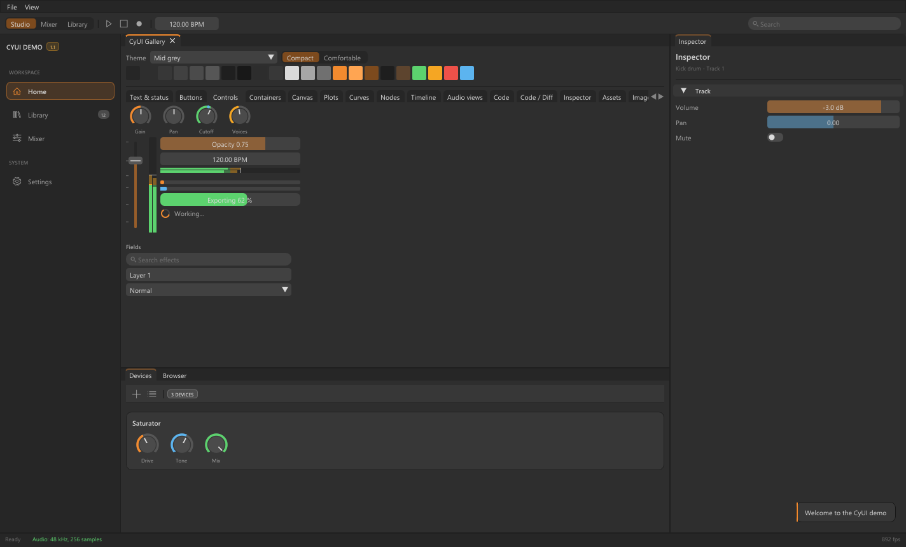

## Module showcase

These are captures of the running C++ gallery. The examples use synthetic data;
applications supply their own models, rendering, processing and services.

### Audio displays

Stereo waveforms, logarithmic spectra, oscilloscopes and stereo scopes share the
same palette as the knobs, faders and meters. `AudioViews` displays prepared data;
audio decoding, FFTs and DSP remain in the application.

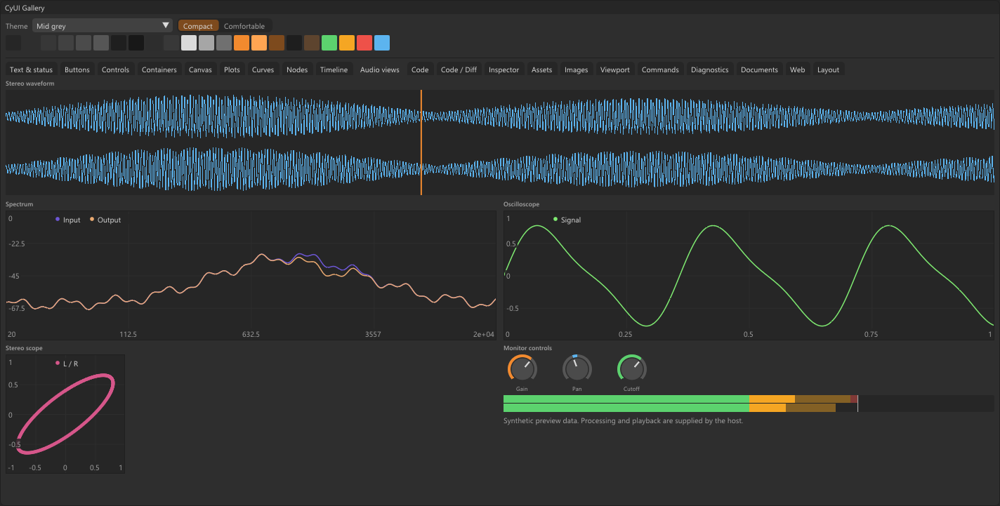

### Blueprint-style node graphs

Colored pins, curved connections, selection, dragging, pan/zoom and automatic
layout provide a foundation for visual editors. The application defines pin
compatibility, graph validation and execution.

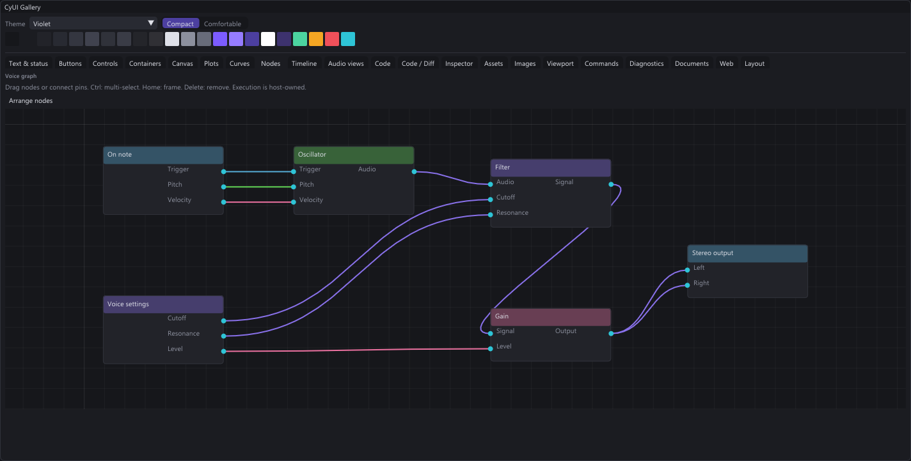

### Code editing and comparison

`Code` provides syntax-colored source views and annotations. `CodeEditor` adds
native editing with Undo/Redo and advanced editor hooks. `Diff` presents unified
or side-by-side comparisons; repository access stays in the host application.

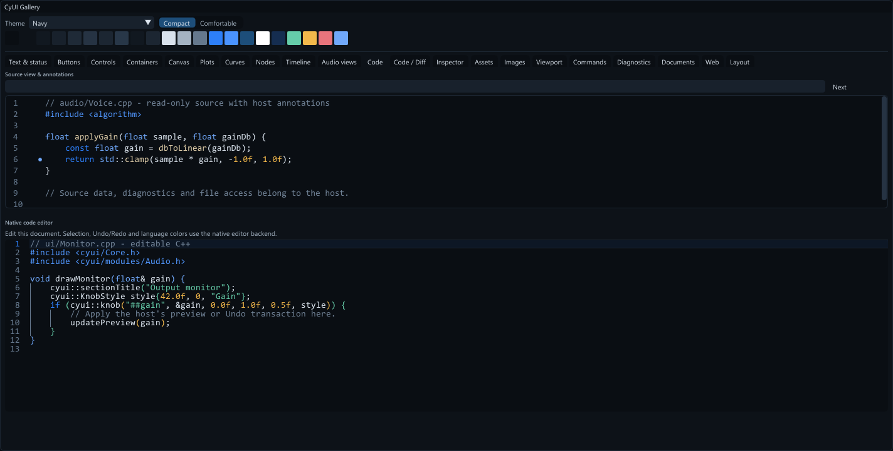

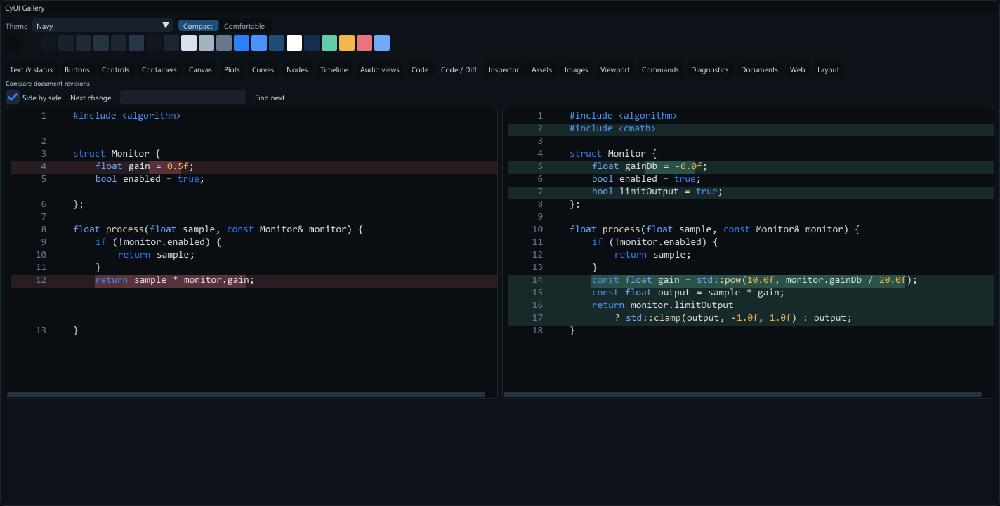

### Plots, automation and timelines

| Frequency response, distributions and heatmaps | Editable automation curves |
| --- | --- |
| 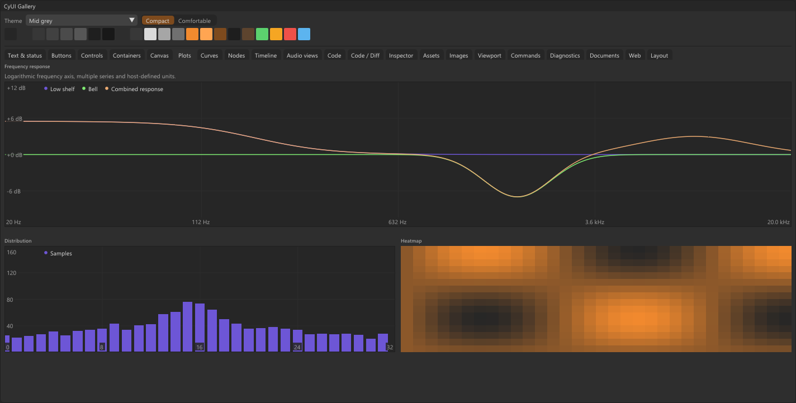 | 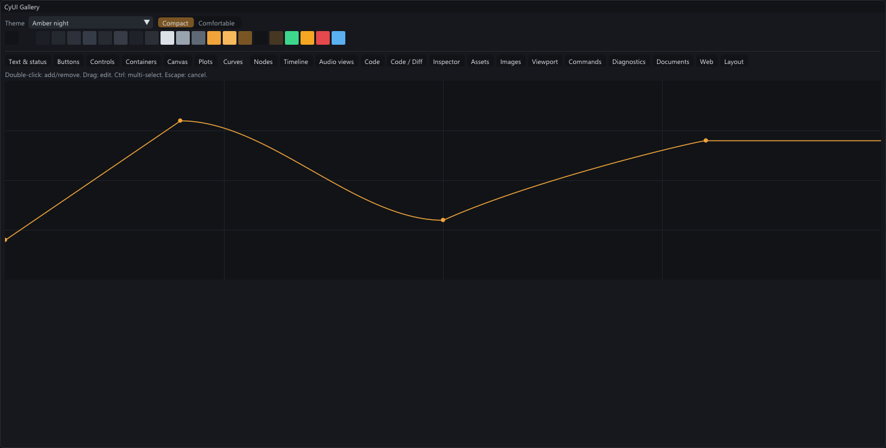 |

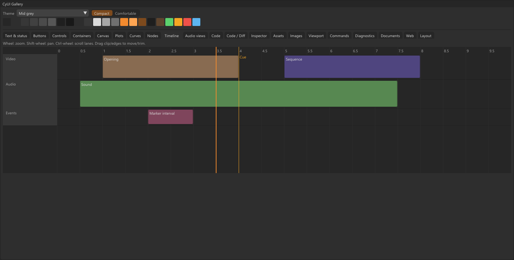

## Choose your modules

Each C++ module is a separate static-library target. Dependencies between modules
are selected automatically; for example, `Diff` brings in `Code` and Core, without
adding a code editor, audio engine or browser.

| Target | What it provides |
| --- | --- |
| `CyUI::Core` | Themes, fonts, icons, buttons, fields, cards, tables, layout and notifications |
| `CyUI::Audio` | Knobs, faders and peak/RMS meters |
| `CyUI::Canvas` | Grid, clipping, double-precision coordinates, pan and zoom |
| `CyUI::Plots` | Linear/log plots, lines, points, steps, bars, histograms and heatmaps |
| `CyUI::Curves` | Keyframes, Bezier handles, snapping, selection and edit transactions |
| `CyUI::Nodes` | Connected cards and pins, graph navigation and layout |
| `CyUI::Timeline` | Clip lanes, trimming, markers, playhead and range selection |
| `CyUI::AudioViews` | Waveforms, spectra, oscilloscopes and stereo scopes |
| `CyUI::Code` | Source views, syntax colors, annotations and search |
| `CyUI::CodeEditor` | Editable source using the bundled MIT TextEditor backend |
| `CyUI::Diff` | Unified/split comparisons, inline changes and hunk navigation |
| `CyUI::Inspector` | Typed properties, validation and draft edits |
| `CyUI::Assets` | Folder trees, grids/lists, thumbnails, filtering and drag/drop |
| `CyUI::Images` | Image navigation, checkerboard, crop and gradient stops |
| `CyUI::Viewport` | Host-rendered scene surfaces, orbit camera and 2D transform controls |
| `CyUI::Commands` | Searchable keyboard command palette |
| `CyUI::Diagnostics` | Bounded logs, filters and diagnostic navigation |
| `CyUI::DocumentViews` | Markdown subset, code blocks, tables, links and transcripts |
| `CyUI::Web` | Browser surface, input, origin policy, messages and theme bridge |
| `CyUI::Gallery` | Widget/module examples and the theme editor |

The optional `CyUI::WebCEF` and `CyUI::ImGuizmo` adapters use host-supplied
dependencies. Neither is downloaded or enabled by `CYUI_MODULES=All`.
See [module dependencies and APIs](docs/MODULES.md).

## C++ quick start

Requirements: **Dear ImGui >= 1.92**, **C++17** and **CMake >= 3.16**.
CodeEditor and the optional CEF adapter require C++20. The docking branch of
ImGui is recommended for applications that use docking.

Add CyUI to your source tree, for example as `external/CyUI`. Supply your existing
ImGui target so the application and CyUI share one ImGui instance:

```cmake
set(CYUI_IMGUI_TARGET app_imgui)
set(CYUI_BUILD_DEMO OFF)
set(CYUI_BUILD_AUDIO OFF)
set(CYUI_BUILD_GALLERY OFF)
set(CYUI_MODULES "Diff;Inspector")
add_subdirectory(external/CyUI)

target_link_libraries(app PRIVATE CyUI::Diff CyUI::Inspector)
```

Use `CYUI_MODULES "Core"` and `CyUI::Core` for the foundation alone. Include
`<cyui/Core.h>` and the headers of the modules you use:

```cpp
#include <cyui/Core.h>
#include <cyui/modules/Diff.h>
#include <cyui/modules/Inspector.h>

// After ImGui::CreateContext(), before the first frame:
cyui::Config config;
config.themeKey = "mid-grey";
config.density = cyui::Density::compact;
config.dpiScale = dpiScale;
cyui::apply(config);
cyui::loadFonts();

// During an ImGui frame:
if (cyui::primaryButton("Save")) {
    saveDocument();
    cyui::notify("Saved", cyui::Tone::success);
}
cyui::renderNotifications(); // At the end of the UI frame.
```

`CyUI::CyUI` and `<cyui/CyUI.h>` remain compatibility umbrellas for the modules
selected in the build. Audio and Gallery keep their original ON defaults;
disable their options explicitly when unused. Host builds default to no other
optional modules. Ordinary ImGui widgets continue to work with the active theme.

CyUI integrates through `add_subdirectory` or `FetchContent`. It does not provide
an installed `find_package(CyUI)` package: it compiles against the host's ImGui
target. See the [integration and migration guide](docs/AI_GUIDE.md).

## Themes and sizing

Five built-in themes share semantic color roles and two densities, **compact**
and **comfortable**. Use `cyui::palette()` for interface colors and `cyui::dp()`
or ImGui style metrics for sizes. Themes can be edited and saved as `.cytheme`.

| Key | Appearance |
| --- | --- |
| `mid-grey` | Mid greys with an orange accent; the default |
| `light-grey` | Light surfaces with dark text and an orange accent |
| `amber-night` | Dark blue-grey surfaces with an amber accent |
| `violet` | Dark slate surfaces with a violet accent |
| `navy` | Deep navy surfaces with a blue accent |

| Light grey | Violet | Navy |
| --- | --- | --- |
| 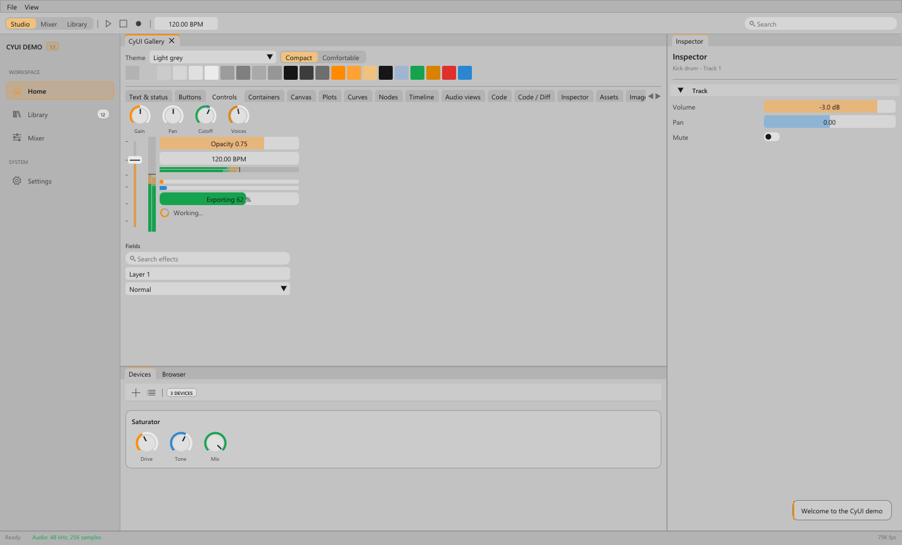 | 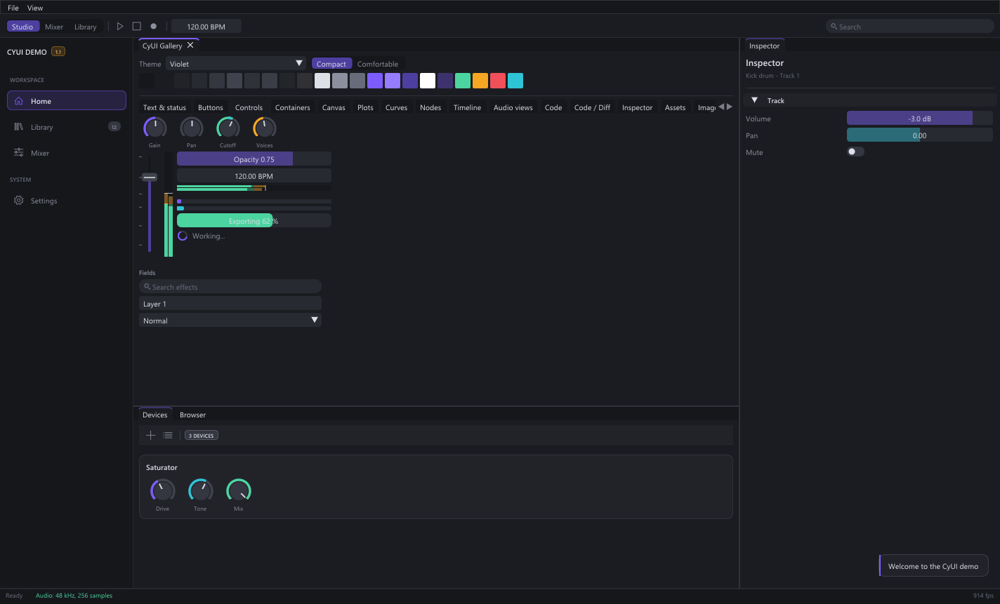 | 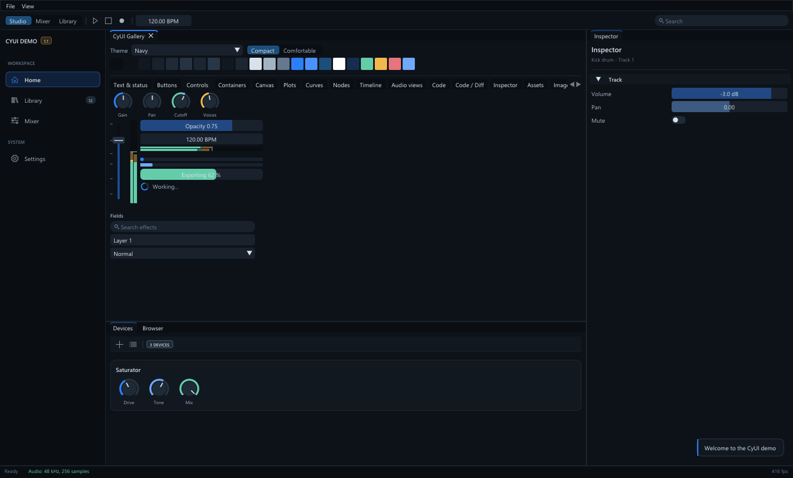 |

Fonts and icons are loaded from the OS or host-provided files, rather than
redistributed. Supply suitable fonts and fallbacks for the platforms and scripts
your application supports. Theme, DPI, fonts and notifications are per ImGui
context; initialize each context separately.

## Python

```sh
python -m pip install -e .
```

The package installs `imgui-bundle`. `cyui` provides the theme and ordinary
widgets; import optional families explicitly from `cyui_modules`, such as
`cyui_modules.plots`, `cyui_modules.diff` or `cyui_modules.audioviews`.
Models can be imported without loading a renderer or media engine. Python's
editor uses multiline editing with a syntax preview; it does not expose every
feature of the C++ TextEditor backend.

See the [Python gallery](examples/python_modules.py) and [module guide](docs/MODULES.md#python).

## Web and Unreal Editor

- **Web:** embed HTML/JavaScript interfaces, including compiled TypeScript,
  through a host backend or the optional off-screen CEF adapter. The `web/`
  bridge provides JavaScript messaging, TypeScript declarations and theme CSS
  variables. CEF runtimes are supplied separately per OS/architecture. See
  [Web integration, lifecycle and deployment](docs/WEB.md).
- **Unreal Editor:** embed CyUI in Slate panels using the optional Editor module.
  Select the included modules when packaging, then use a shared provider or a
  uniquely named embedded copy. Loading it adds no menus or tool windows.
  It is an Editor integration, not a runtime/UMG backend. See
  [Unreal integration and supported configurations](docs/UNREAL.md).

## Build the demo

On Windows, with the Visual Studio 2022 C++ tools:

```bat
build_demo.bat
build\cyui_demo.exe
```

The demo builds the bundled Dear ImGui and all ordinary modules. Its gallery
contains interactive examples, a theme selector and a theme editor.

```bat
build\cyui_demo.exe --capture out.bmp --theme violet --tab 7 --gallery-only
```

`--gallery-only` shows the selected gallery page across the window for module
previews. Add `--comfortable` to switch density. To regenerate the README images
from the built demo, install Pillow and run:

```sh
python -m pip install Pillow
python tools/capture_readme.py
```

See [the build and visual-check instructions](docs/AI_GUIDE.md#7-build-and-check)
and the repository's native, Python, Web and Unreal tests.

## Documentation and license

- [Integration, style rules, API and migration recipes](docs/AI_GUIDE.md)
- [Module boundaries and dependency selection](docs/MODULES.md)
- [Web / CEF](docs/WEB.md) and [Unreal Editor](docs/UNREAL.md)
- [MIT license](LICENSE), [licensing guide](docs/LICENSING.md) and
  [third-party notices](THIRD_PARTY_NOTICES.md)

CyUI's own code, examples, Python modules and browser/engine adapters are MIT
licensed. Dependencies retain their own licenses and notices. The repository
does not include CEF or Unreal Engine binaries.

For coding agents, read `docs/AI_GUIDE.md` before integrating CyUI or migrating an
existing interface. Keep application models and business logic in the host.

For local development, install [Gitleaks](https://github.com/gitleaks/gitleaks/releases)
and enable the supplied pre-commit hook in your clone:

```sh
git config --local core.hooksPath .githooks
```
